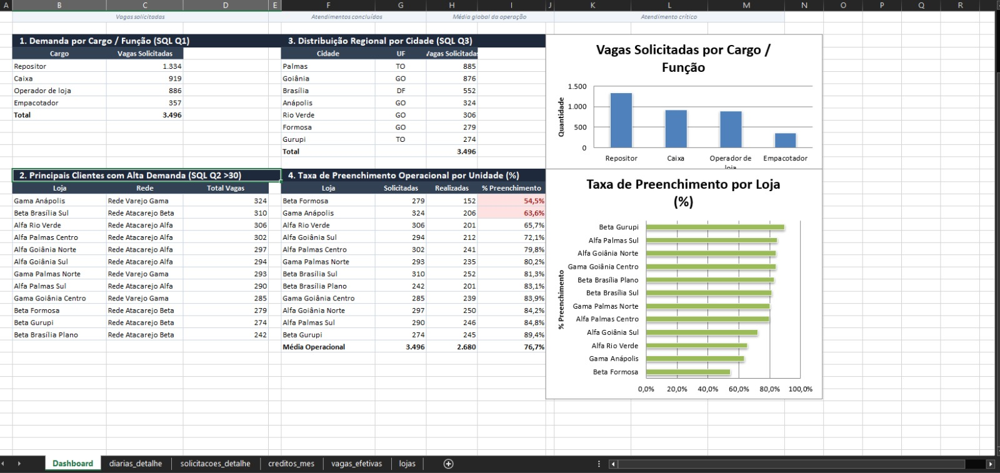

# 📊 SAMA Operational Shift Fulfillment Analysis

> ⚠️ **DISCLAIMER:** All data in this repository is **100% fictional and simulated** to protect company confidentiality.

---

## 📌 Business Overview & AI Collaboration
In retail staffing operations (connecting supermarket chains with freelance workers for roles such as cashiers, stock replenishment, and floor operators), maintaining a high **Shift Fulfillment Rate** is critical to prevent store disruptions and client revenue loss.

To analyze this real-world problem safely, **I used Generative AI as a virtual assistant ("intern")** to architect a realistic SQLite relational database (`diarias_exemplo.db`). By prompting the AI with domain rules from my daily experience in HR operations at SAMA, we generated simulated shift logs, store profiles, and request records.

---

## 🔍 The Business Problem
- **Unfilled Shift Requests:** Daily request fluctuations lead to dropouts and recruitment bottlenecks.
- **Client Impact:** Low fill rates hurt wholesale retail client operations.
- **Goal:** Diagnose fill rates, quantify dropouts per store, and prioritize recruiter sourcing.

---

## 🛠️ Methodology & Tech Stack

### 1. Relational Querying (SQL - SQLite)
- Querying multi-table schemas (`solicitacoes`, `lojas`, `redes`, `funcoes`).
- Performing `INNER JOIN` operations and aggregations using `GROUP BY`.
- Filtering high-volume accounts with `HAVING SUM(qtd_solicitada) > 30`.

### 2. Executive Dashboard (Microsoft Excel)
- Built pivot tables and executive KPI summary cards.
- Formatted visual bar charts to highlight low-performing store fill rates against the global average.

---

## 📊 Key Findings & Strategic Insights

- **Global Fill Rate:** The operational average stands at **76.66%** across **3,496 requested shifts**.
- **Critical Operational Bottleneck:** **Beta Formosa** holds the lowest fulfillment rate at **54.48%**, requiring urgent recruiter intervention.
- **Top Demand Client:** **Gama Anápolis** leads request volume with **324 shifts**.

---

## 📁 Repository Structure
- `dashboard.png`: Executive KPI dashboard preview.
- `queries.sql`: Complete SQL script with aggregation and join queries.
- `diarias_exemplo.db`: SQLite database built with AI-assisted simulated data.
- `base_para_excel.xlsx`: Complete workbook with data, pivot tables, and KPI dashboard.
